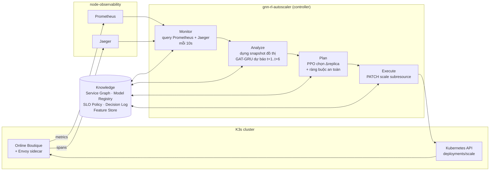

# thesis-gnn-rl-autoscaling

> **Cập nhật 07/11/2026:** synthetic recovery v4 đã PASS toàn bộ gate cho thiết kế
> focus-sweep 20/8/8 mới. Campaign thật vẫn **NO-GO** vì observation contract
> (capture/own-time/downstream evidence) chưa được xác minh. Quyết định hiện hành nằm ở
> [campaign_readiness.md](docs/campaign_readiness.md); mô tả recovery v3 bên dưới là lịch sử.

> Trạng thái collection v2 (06/11/2026): **chưa chạy campaign chính thức**.
> Xem [campaign readiness](docs/campaign_readiness.md) để dùng đúng protocol,
> tách dữ liệu diagnostic và kiểm tra điều kiện nhận dạng Digital Twin.

**Tối ưu hóa autoscaling chủ động cho ứng dụng microservices sử dụng mạng nơ-ron đồ thị và học tăng cường**
*(Proactive autoscaling optimization for microservices applications using graph neural networks and reinforcement learning)*

Khóa luận tốt nghiệp, Khoa Mạng máy tính và Truyền thông, Trường ĐH Công nghệ Thông tin, ĐHQG TP.HCM.
GVHD: TS. Huỳnh Văn Đặng. Sinh viên: Lê Trung Kiên (23520797), Trần Thị Thùy Tiên (23521588).

Repo chứa toàn bộ hạ tầng dưới dạng code: tạo máy ảo, dựng cụm Kubernetes, triển khai ứng dụng benchmark, giám sát/truy vết, sinh tải và thu thập dữ liệu. Đây là nền tảng để huấn luyện và đánh giá cơ chế autoscaling **GAT-GRU + PPO** so với **Kubernetes HPA**.

**Trạng thái hiện tại (05/11/2026):** đã có dataset 32 run và bộ bàn giao GAT-GRU v05. Đường RL hiện tại là [Digital Twin + PPO trên Kaggle](notebooks/rl/train_ppo_kaggle.ipynb); campaign hiệu chỉnh Digital Twin chưa được thu đầy đủ và chưa có policy được đánh giá trên cụm thật.

- Phạm vi hiện tại: **NHPP, MMPP, Pareto, ON/OFF; không curriculum; Jaeger sampling 10%**. Những mục khác trong đề cương/báo cáo tiến độ cũ được giữ như lịch sử.
- RL theo [Digital Twin bán cơ chế có hiệu chỉnh xác suất](docs/RL_DESIGN_PLAN.md): workload trace, replica lifecycle, queue/backlog, CPU work-conservation và mixture-density latency. PPO vẫn bị chặn tới khi calibration validation đạt gate.
- Audit collection v2 hiện kết luận **NO-GO cho campaign chính thức và PPO**: recovery
  chưa nhận dạng được capacity `mu`, support replica2/3 còn thiếu và observation contract
  thực chưa được xác minh. Quyết định chuẩn nằm trong [campaign readiness](docs/campaign_readiness.md).
- [Bàn giao DL → RL](README_DL_TO_RL_HANDOFF.md) là nguồn cho contract model; [kế hoạch RL](docs/RL_DESIGN_PLAN.md) mô tả công việc tiếp theo.
- [Notebook RL trên Kaggle](notebooks/rl/train_ppo_kaggle.ipynb) là artifact huấn luyện duy nhất; lịch sử surrogate v5–v16 không còn nằm trên đường chạy hiện tại.

---

## Mục lục

1. [Tổng quan đề tài](#1-tổng-quan-đề-tài)
2. [Hạ tầng](#2-hạ-tầng)
3. [Công cụ, công nghệ và mục tiêu sử dụng](#3-công-cụ-công-nghệ-và-mục-tiêu-sử-dụng)
4. [Cấu trúc repo và thứ tự triển khai](#4-cấu-trúc-repo-và-thứ-tự-triển-khai)
5. [Bài toán: GAT-GRU và PPO](#5-bài-toán-gat-gru-và-ppo)
6. [Bộ dataset](#6-bộ-dataset)
7. [Vòng lặp MAPE-K và đề xuất tích hợp pha Knowledge](#7-vòng-lặp-mape-k-và-đề-xuất-tích-hợp-pha-knowledge)
8. [Đề xuất đưa mô hình vào cụm](#8-đề-xuất-đưa-mô-hình-vào-cụm)
9. [Kịch bản thực nghiệm cuối: so sánh với HPA](#9-kịch-bản-thực-nghiệm-cuối-so-sánh-với-hpa)
10. [Bảo mật và lưu ý vận hành](#10-bảo-mật-và-lưu-ý-vận-hành)

---

## 1. Tổng quan đề tài

Các microservice gọi lẫn nhau tạo thành một **đồ thị phụ thuộc**. Khi tải tăng đột biến, độ trễ tại một service có thể lan dọc chuỗi gọi và gây hiệu ứng dây chuyền (cascading failure). Kubernetes HPA mặc định có hai hạn chế:
- **Phản ứng thụ động (reactive):** quyết định dựa trên metric hiện tại/quá khứ; thời gian pod mới sẵn sàng cần đo trên cụm.
- **Xét từng service riêng lẻ:** bỏ qua quan hệ phụ thuộc, nên service downstream chỉ được scale khi tải đã dồn tới nó.

Đề tài đề xuất cơ chế **proactive horizontal autoscaling** tổ chức theo vòng lặp **MAPE-K**:
- **GAT-GRU** dự báo nhu cầu tải/tài nguyên của từng service trong tương lai gần. GAT khai thác quan hệ không gian trên đồ thị dịch vụ, GRU khai thác quan hệ theo thời gian.
- **PPO** dùng kết quả dự báo để chọn số replica, cân bằng giữa **duy trì SLO**, **hiệu quả tài nguyên** và **độ ổn định** (tránh scale dao động).
- **Controller** thực thi quyết định qua Kubernetes API, và được so sánh với **HPA** và một **proactive baseline**.

Giới hạn (theo đề cương):
- Chỉ scale ngang.
- Chỉ dùng một ứng dụng benchmark (Online Boutique).
- PPO huấn luyện bằng tương tác với simulator ngoài cụm, sau đó triển khai policy online. PPO là on-policy; replay CSV cố định không phải môi trường train autoscaling.
- Tải sinh từ kịch bản có kiểm soát.

---

## 2. Hạ tầng

Môi trường chạy trên **OpenStack (UIT NetChallenge)**, gồm 5 máy ảo trong một private network `10.42.0.0/24`.

```text
                         OpenStack project (quota 16 vCPU / 24 GB RAM / 200 GB)
 ┌────────────────────────────────────────────────────────────────────────────────────────┐
 │  K3s cluster (pod CIDR 10.244.0.0/16, service CIDR 10.96.0.0/16, Flannel VXLAN)        │
 │  ┌──────────────────────┐   ┌───────────────────────┐   ┌───────────────────────┐      │
 │  │ node-app  (2 vCPU)   │   │ node-app-worker-1     │   │ node-app-worker-2     │      │
 │  │ control-plane        │   │ (4 vCPU / 8 GB)       │   │ (4 vCPU / 8 GB)       │      │
 │  │ taint NoSchedule     │   │ Online Boutique pods  │   │ Online Boutique pods  │      │
 │  │ istiod, ServiceLB    │   │ + istio-proxy sidecar │   │ + istio-proxy sidecar │      │
 │  │ Floating IP          │   │ (chỉ fixed IP)        │   │ (chỉ fixed IP)        │      │
 │  └──────────┬───────────┘   └───────────┬───────────┘   └───────────┬───────────┘      │
 │             │ kubelet :10250 (cAdvisor) ◀──────── scrape ─────────────┐                  │
 │             │ Envoy spans (Zipkin) ──────────────────────────────┐  │                  │
 │  ┌──────────┴───────────┐                              ┌──────────▼──┴──────────┐      │
 │  │ node-loadgen (1 vCPU)│ ── HTTP ─▶ frontend-external │ node-observability     │      │
 │  │ Locust + collector   │   (LoadBalancer/ServiceLB)   │ (4 vCPU, Docker)       │      │
 │  │ Floating IP          │ ── query_range / api/traces ▶│ Prometheus :9090       │      │
 │  └──────────────────────┘                              │ Grafana :3000          │      │
 │                                                        │ kube-state-metrics     │      │
 │                                                        │ Jaeger :16686 / :9411  │      │
 │                                                        │ Floating IP            │      │
 │                                                        └────────────────────────┘      │
 └────────────────────────────────────────────────────────────────────────────────────────┘
```

| Node | Vai trò | Flavor | Ghi chú |
|---|---|---|---|
| `node-app` | K3s control-plane | 2 vCPU, 20 GB | Label `node-role=control-plane`, taint `dedicated=control-plane:NoSchedule`; chạy istiod, các system pod và (đề xuất) controller autoscaling |
| `node-app-worker-1`, `node-app-worker-2` | Application worker | 4 vCPU / 8 GB, 40 GB | Label `node-role=app-worker`; nhận toàn bộ pod Online Boutique (preferred anti-affinity giữa hai worker) |
| `node-observability` | Giám sát, truy vết | 4 vCPU, 50 GB | **Ngoài cụm**, Docker Compose: Prometheus, Grafana, kube-state-metrics, Jaeger |
| `node-loadgen` | Sinh tải | 1 vCPU, 30 GB | **Ngoài cụm**: Locust và script xuất telemetry |

**Nguyên tắc thiết kế:** giám sát và sinh tải đặt **ngoài cụm** để giảm tranh chấp tài nguyên với ứng dụng đang được đo. Chất lượng telemetry vẫn được kiểm tra riêng trong từng run.

Chi tiết: [`terraform-openstack/README.md`](terraform-openstack/README.md), [`cluster-setup/README.md`](cluster-setup/README.md).

---

## 3. Công cụ, công nghệ và mục tiêu sử dụng

| Lớp | Công nghệ (phiên bản) | Mục tiêu trong đề tài |
|---|---|---|
| Hạ tầng đám mây | **OpenStack** (Nova, Neutron, Cinder) | Cung cấp máy ảo, mạng riêng, Floating IP, security group cho môi trường thực nghiệm thật |
| Infrastructure as Code | **Terraform** ≥ 1.6, provider `openstack` v3.x | Mô tả 5 VM, mạng, security group dưới dạng code: dựng lại và hủy được, tái lập được khi hạ tầng hỏng hoặc đổi IP |
| Điều phối container | **K3s** `v1.34.9+k3s1` | Kubernetes nhẹ, phù hợp VM nhỏ. Có sẵn **metrics-server** (cho HPA baseline) và **ServiceLB** (expose frontend). Traefik bị tắt |
| Mạng cụm | **Flannel** (VXLAN, mặc định của K3s) | Mạng pod giữa 3 node |
| Đóng gói ứng dụng | **Helm** | Triển khai Online Boutique từ chart upstream (vendor theo commit), kèm patch resource, probe, anti-affinity tái lập được |
| Ứng dụng benchmark | **Online Boutique** (Google `microservices-demo`) | 11 microservice (Go, C#, Node.js, Python, Java) gọi nhau qua gRPC: đồ thị phụ thuộc thực tế, nhiều ngôn ngữ, có chuỗi checkout sâu |
| Service mesh | **Istio** `1.31.0` (profile minimal, Envoy sidecar) | Envoy được cấu hình phát span cho lời gọi giữa service mà không sửa code ứng dụng; các span quan sát được là nguồn dữ liệu cạnh của đồ thị |
| Thu metric | **Prometheus** `v2.54.1` | Scrape cAdvisor trên 3 kubelet và kube-state-metrics mỗi 10s; cung cấp `query_range` để xuất dữ liệu và (đề xuất) phục vụ pha Monitor của controller |
| Metric container | **cAdvisor** (tích hợp kubelet) | CPU, memory, network, CPU throttling theo container/pod |
| Metric trạng thái K8s | **kube-state-metrics** `v2.13.0` | Số replica, request/limit, restart: năng lực hiện tại và biến PPO điều khiển |
| Truy vết phân tán | **Jaeger** `1.60.0` all-in-one, lưu trữ Badger | Sampling cấu hình hiện tại **10%**; cung cấp RPS, latency và lỗi quan sát từ trace. Metadata raw cũ chưa xác nhận sampling lúc thu; phải kiểm tra tương thích trước khi dùng model trên telemetry mới |
| Trực quan hóa | **Grafana** `11.2.0` | Dashboard theo dõi trong lúc thu dữ liệu và thực nghiệm |
| Sinh tải | **Locust** `2.31.8` | Mô phỏng người mua hàng. Driver gevent phát lại trace NHPP / MMPP / Bounded Pareto / ON/OFF (mô hình luồng đến mở) |
| Xử lý dữ liệu | **Python**, NumPy, pandas, Matplotlib, Jupyter | Xuất telemetry, tiền xử lý, tạo tensor đồ thị cho GAT-GRU |
| Học máy | **PyTorch** (GAT có feature cạnh viết thuần, không cần PyTorch Geometric) | Cài đặt và huấn luyện GAT-GRU và baseline LSTM (`modeling-common/forecast_torch.py`) |
| Tìm siêu tham số | **Optuna** (TPE sampler, Median pruner) | Tune GAT-GRU và LSTM với cùng ngân sách để so sánh công bằng |
| Autoscaler baseline | **Kubernetes HPA** `autoscaling/v2` (metrics-server của K3s) | CPU 70% của container ứng dụng (`ContainerResource`), scale down sau 5 phút; vừa là baseline, vừa là "chính sách hành vi" khi thu dữ liệu có scaling |
| Học tăng cường *(đề xuất)* | **Gymnasium**, **Stable-Baselines3** (PPO) | Môi trường RL offline và huấn luyện tác tử PPO |
| Controller *(đề xuất)* | Python `kubernetes` client, ONNX Runtime / TorchScript | Chạy vòng lặp MAPE-K trong cụm, gọi `scale` subresource của Deployment |
| Tự động hóa | Bash, SSH (ProxyJump), rsync, jq | Các script cài đặt 00–06, chạy kịch bản và kéo kết quả |

---

## 4. Cấu trúc repo và thứ tự triển khai

```text
thesis-gnn-rl-autoscaling/
├── terraform-openstack/         # IaC: 5 VM, mạng, security group, Floating IP
│   ├── environments/dev/        #   root module + terraform.tfvars (không commit)
│   ├── modules/                 #   networking, security-group, keypair, compute, floating-ip
│   └── scripts/replace-floating-ips.sh
├── cluster-setup/               # Script dựng cụm và các dịch vụ, chạy tuần tự 00 → 07
│   ├── 00-generate-node-ips.sh  #   sinh node-ips.env từ terraform output
│   ├── 01-install-server.sh     #   K3s control-plane + token Prometheus
│   ├── 01b-install-worker.sh    #   join worker qua ProxyJump
│   ├── 02-install-istio.sh      #   Istio + ServiceEntry Jaeger + injection
│   ├── 03-deploy-online-boutique.sh
│   ├── 04-setup-monitoring.sh   #   Prometheus, Grafana, KSM, Jaeger trên node-observability
│   ├── 05-setup-tracing.sh      #   áp dụng istio-tracing.yaml (sampling 10%) + rollout
│   ├── 06-setup-loadgen.sh      #   Locust venv trên node-loadgen
│   ├── 07-setup-hpa.sh          #   bật/tắt HPA baseline (apply | delete | status)
│   └── verify-istio-injection.sh
├── k8s-manifests/
│   ├── online-boutique/         # Helm chart (vendor) + values-override.yaml
│   └── hpa/hpa-online-boutique.yaml  # HPA: CPU 70% container 'server', scale down sau 5 phút
├── monitoring-stack/            # docker-compose, prometheus.yml, Grafana provisioning
├── dataset/                     # Một dataset canonical dùng chung cho mọi mô hình
│   ├── raw/{nhpp,mmpp,pareto,onoff}/run_XX/  # 448 raw files, bắt buộc push
│   ├── processed/{gatgru,lstm}/ # cache sinh lại được, không push Git thường
│   ├── splits.json              # frozen split train/val/test dùng chung
│   └── DATASET.md, DATASET_GUIDE.md
├── load-testing/                # Sinh tải và thu telemetry vào dataset/raw
│   ├── arrival_models.py, scenarios/{nhpp,mmpp,pareto,onoff}.py
│   ├── locustfile.py, run-scenario.sh, collect_metrics.py
│   └── README.md
├── notebooks/                   # Chỉ chứa notebook, chia theo model/chức năng
│   ├── dataset/                 # phân tích workload và chất lượng Jaeger
│   ├── gatgru/, gatlstm/, lstm/, gru/
│   ├── rl/train_ppo_kaggle.ipynb # prototype simulator + PPO; output simulation-only
│   └── comparison/
├── artifacts/                   # Checkpoint, prediction, metric và tuning output
│   ├── gatgru/, gatlstm/, lstm/, gru/
│   └── comparison/
├── configs/gatgru/              # Frozen feature contract và graph contract cho inference
├── docs/RL_DESIGN_PLAN.md        # Thiết kế RL và điều kiện trước khi train chính thức
└── modeling-common/             # Code dùng chung: dữ liệu, mô hình, Optuna, metric
    └── forecast_data.py, feature_selection.py, forecast_torch.py, forecast_metrics.py
```

Thứ tự triển khai (chi tiết trong từng README):

```bash
# 1. Hạ tầng
cd terraform-openstack && source openstack-openrc.sh
terraform -chdir=environments/dev init && terraform -chdir=environments/dev apply
cd ..
# 2. Cụm và dịch vụ
bash cluster-setup/00-generate-node-ips.sh
bash cluster-setup/01-install-server.sh
source cluster-setup/node-ips.env
bash cluster-setup/01b-install-worker.sh "$NODE_WORKER1_FIXED_IP"
bash cluster-setup/01b-install-worker.sh "$NODE_WORKER2_FIXED_IP"
bash cluster-setup/02-install-istio.sh
bash cluster-setup/03-deploy-online-boutique.sh
bash cluster-setup/00-generate-node-ips.sh      # cập nhật FRONTEND_URL sau khi có frontend-external
bash cluster-setup/04-setup-monitoring.sh
bash cluster-setup/05-setup-tracing.sh
bash cluster-setup/06-setup-loadgen.sh
# 3. Thu dữ liệu (xem load-testing/README.md)
bash cluster-setup/07-setup-hpa.sh apply                    # dataset luôn được thu khi HPA bật
#    trên node-loadgen, chạy từng scenario và kiểm tra/reset Jaeger theo load-testing/README.md:
bash load-testing/run-scenario.sh nhpp 8
# 4. Mô hình (pip install -r modeling-common/requirements-ml.txt)
#    notebooks/gatgru/: preprocess → feature selection → train
#    notebooks/lstm/:   preprocess → feature selection → train
#    notebooks/comparison/: đánh giá các model trên cùng split
```

---

## 5. Bài toán: GAT-GRU và PPO

### 5.1 Mô hình hóa hệ thống thành đồ thị theo thời gian

Tại mỗi bước thời gian $t$ (10 giây), hệ thống được biểu diễn bằng đồ thị $\mathcal{G}_t = (V, E, X_t, A_t)$:
- $V$: 11 service của Online Boutique (nút).
- $E$: quan hệ gọi dịch vụ, gồm topology tĩnh và các cạnh quan sát được từ trace (cạnh có hướng `caller → callee`).
- $X_t \in \mathbb{R}^{N \times F}$: đặc trưng nút (tải, latency, lỗi, CPU, memory, network, replica, ...).
- $A_t \in \mathbb{R}^{M \times F_e}$: đặc trưng cạnh (tần suất gọi, tỉ lệ fan-out, latency, lỗi).

### 5.2 GAT-GRU: dự báo nhu cầu

$$\hat{Y}_{t+1:t+h} = f_\theta\left(\mathcal{G}_{t-w+1}, \dots, \mathcal{G}_t\right), \qquad \hat{Y} \in \mathbb{R}^{h \times N \times K}$$

- **Đầu vào:** chuỗi $w = 18$ snapshot, tương ứng 180 giây.
- **Đầu ra:** dự báo $h = 6$ bước (60s) cho $K = 2$ target của mỗi service: `rps_in` quan sát từ Jaeger và `cpu_cores` quan sát từ Prometheus. Forecast là tín hiệu đầu vào cho RL; hiệu quả autoscaling phải được đánh giá riêng trong closed loop.
- **Kiến trúc đề xuất:**
  1. **GAT** tại từng bước $\tau$: mỗi service tổng hợp thông tin từ các service láng giềng với trọng số attention $\alpha_{ij}$ học từ dữ liệu, có dùng đặc trưng cạnh $A_\tau$. Attention cho phép mô hình học *mức độ phụ thuộc động*: cạnh gọi nhiều hoặc chậm thì ảnh hưởng nhiều hơn.
  2. **GRU** chạy trên chuỗi embedding của từng nút (trọng số chia sẻ giữa các nút) để nắm xu hướng theo thời gian.
  3. **Đầu ra tuyến tính** cho $h \times K$ giá trị mỗi nút.
- **Huấn luyện:** loss Huber trên target đã chuẩn hóa, AdamW, early stopping. **Đánh giá:** MAE, RMSE trên đơn vị gốc (trung bình ± độ lệch chuẩn qua 5 seed), so với baseline persistence ($\hat y_{t+k} = y_t$).
- **Feature contract v05:** 10 node features và 3 edge features được đóng băng trong `configs/gatgru/feature_contract_v01.json`. Quá trình lựa chọn chỉ sử dụng train/validation:
  1. lọc thống kê: loại feature gần hằng số; đo độ liên quan bằng \|Spearman ρ\| với target tương lai; loại feature trùng lặp (\|ρ\| > 0,95);
  2. permutation importance trên val;
  3. huấn luyện lại để xác nhận tập feature đã chọn.

  Feature luôn giữ: `rps_in`, `cpu_cores`, `replicas`.
- **Tìm siêu tham số:** Optuna 24 trial cho cấu hình v05; kết quả tốt nhất dùng window 18, hai lớp GAT, bốn attention heads, GAT hidden 32 và GRU hidden 128.
- **Baseline LSTM** ([`notebooks/lstm/`](notebooks/lstm/README.md)): artifact `v01_shared_selected_features` dùng cùng run, split, 10 node features và protocol đánh giá với GAT-GRU v05; khác biệt chính là không có graph input/message passing. Artifact `v02_node_only_selected_features` là baseline bổ sung với feature contract riêng. Code dùng chung nằm trong [`modeling-common/`](modeling-common/README.md).

### 5.3 PPO: quyết định số replica

| Thành phần | Định nghĩa đề xuất |
|---|---|
| **State** $s_t$ | RPS, CPU, RAM, P95, trace count, ready, pending, cooldown, backlog và OOD score của năm service điều khiển; forecast RPS/CPU +30s/+60s; edge features; cùng `reward_p95_ema/SLO` để reward filter không là hidden state |
| **Action** $a_t$ | `MultiDiscrete([3] * 5)`, mã `0/1/2` tương ứng delta `-1/0/+1` cho frontend, cartservice, currencyservice, productcatalogservice và recommendationservice. Miền hiệu chỉnh hiện tại là 1..3 |
| **Reward** $r_t$ | Bốn nhóm: SLA (P95/error frontend), resource (tổng replica), flapping (service thực sự đổi replica) và OOD. Reversal/blocked chỉ được log; P95 reward dùng EWMA `alpha=min(1,K/30)` với nhánh `K=0` chống NaN |
| **Transition** | Digital Twin tách `ReplicaLifecycle`, `GraphLoadModel`, `InfrastructureDynamics` và `SurrogateObservationModel`: tải lan truyền caller→callee, Pod mới pending trước khi ready, queue/backlog bảo toàn work; lớp quan sát tái tạo sampling Jaeger 10% và feature X/E |
| **Huấn luyện** | Lấy mẫu cân bằng **cả bốn scenario ngay từ đầu, không curriculum**. Giữ train/validation/test tách biệt; không dùng prediction test để train hoặc tune |
| **Đầu ra** | Policy PPO, observation normalizer, cấu hình, seed và provenance. Dùng PyTorch/SB3 trước; ONNX/TorchScript là tùy chọn sau kiểm thử parity |

Điều kiện trước khi train chính thức: inference parity đạt; dữ liệu replica được audit; feature sampling 10% được đối chiếu; simulator qua kiểm tra action-response và rollout validation. Raw hiện có service luôn ở một replica và giá trị `currencyservice.replicas_desired` tới 13, khác trần HPA hiện tại 10; cần xác minh cấu hình lúc thu/cách tổng hợp, không tự sửa raw cho khớp manifest.

---

## 6. Bộ dataset

Dataset canonical nằm trong [`dataset/raw/`](dataset/), dùng chung cho GAT-GRU, LSTM và PPO. Tải được sinh bằng code trong [`load-testing/`](load-testing/README.md) theo **mô hình luồng đến mở**: driver phát lại trace sinh trước từ mô hình toán, nên lịch arrival không tự giảm khi hệ thống phản hồi chậm. Mỗi run có `designed_rate.csv` làm tham chiếu tải thiết kế; các bộ sinh đã được kiểm định thống kê (KS test, phân phối lưu trú MMPP, hệ số Hurst). Mọi run được thu khi **HPA bật**. Kiến thức về thu dataset: [`dataset/DATASET_GUIDE.md`](dataset/DATASET_GUIDE.md).

| Khía cạnh | Mô tả |
|---|---|
| Kịch bản | **NHPP** (λ(t) hình sin chu kỳ 15 phút, 3–80 rps), **MMPP** (3 trạng thái Idle/Normal/High ≈ 9/21/90 rps, chuyển trạng thái ngẫu nhiên), **Bounded Pareto** (≈ 20 rps, số sản phẩm mỗi đơn đuôi nặng), **ON/OFF** (60 nguồn đuôi nặng, ≈ 27 rps, tự tương tự) |
| Quy mô | 8 run × 30 phút cho mỗi kịch bản, tổng 32 run. Với contract v05: 3.661 train windows, 609 validation windows và 611 test windows. HPA bật trong mọi run |
| Nguồn | Prometheus (cAdvisor + kube-state-metrics), Jaeger (span Envoy), driver (trace tải và báo cáo Locust, chỉ dùng để kiểm tra coverage và đối chiếu workload đầu vào) |
| Telemetry nút ứng viên | 15 feature được tạo trong preprocessing để phân tích và ablation |
| Input nút v05 (10) | `rps_in`, `rps_in_delta`, `rps_per_replica`, `latency_p50_ms`, `latency_p95_ms`, `cpu_cores`, `mem_mib`, `net_rx_kBps`, `net_tx_kBps`, `replicas` |
| Input cạnh v05 (3) | `call_rate`, `call_ratio`, `edge_latency_p95_ms` |
| Đặc trưng toàn đồ thị (5) | `e2e_rps`, `e2e_latency_p95_ms`, `e2e_error_rate`, `slo_violation`, `total_replicas` |
| Target | `rps_in`, `cpu_cores` của từng service tại $t+1 \dots t+6$ |
| Tiền xử lý | Căn lưới 10s, bỏ warm-up 60s, clip p99,9, `log1p`, z-score (fit trên train), cửa sổ trượt trong từng run, **chia train/val/test theo run** để tránh rò rỉ |
| Cache preprocessing | `dataset/processed/gatgru/` chứa `runs_raw.npz`, `gatgru_dataset.npz`, `metadata.json` và `timeseries_raw.csv`; đây là dữ liệu dẫn xuất và bị Git ignore |
| Artifact v05 | `artifacts/gatgru/v05_selected_features_final/` chứa năm checkpoint, prediction test, metrics và handoff manifest. Input inference là `X [B,18,11,10]`, `E [B,18,15,3]`; output là `[B,6,11,2]` |

Nguyên tắc quan trọng: **chỉ dùng đặc trưng quan sát được khi triển khai thật**. Thông tin của driver (trace tải, tải thiết kế) không được đưa vào mô hình. `rps_in` lấy từ Jaeger phản ánh tải quan sát được từ trace, không phải toàn bộ tải thực khi coverage chưa đầy đủ.

---

## 7. Vòng lặp MAPE-K và đề xuất tích hợp pha Knowledge

### 7.1 Ánh xạ các pha vào kiến trúc



| Pha | Thành phần trong repo | Đã có / đề xuất |
|---|---|---|
| **Monitor** | Prometheus (cAdvisor, KSM), Jaeger (span Envoy), logic truy vấn của `collect_metrics.py` | Đã có. Controller tái sử dụng logic truy vấn này cho cửa sổ 10s gần nhất |
| **Analyze** | Dựng snapshot đồ thị theo `notebooks/gatgru/preprocess_gatgru.ipynb` và các contract trong `configs/gatgru/`, rồi suy luận GAT-GRU | Đề xuất |
| **Plan** | PPO policy và lớp an toàn | Đề xuất |
| **Execute** | Gọi `PATCH /apis/apps/v1/namespaces/online-boutique/deployments/<svc>/scale` | Đề xuất |
| **Knowledge** | Xem 7.2 | Đề xuất |

### 7.2 Đề xuất thiết kế pha Knowledge

Pha K là **bộ nhớ dùng chung** của vòng lặp: các pha khác đọc ngữ cảnh từ đây và ghi kết quả vào đây. Đề xuất gồm 5 thành phần, dùng tối đa hạ tầng đã có:

| Thành phần | Nội dung | Hiện thực đề xuất | Ai đọc / ghi |
|---|---|---|---|
| **Service Graph** | Topology tĩnh, service/edge ordering và graph semantics | Khởi tạo từ `configs/gatgru/graph_metadata.json`; telemetry cạnh được cập nhật từ Jaeger | A đọc topology và tạo edge tensor đúng contract |
| **Model Registry** | Checkpoint GAT-GRU/PPO theo phiên bản, feature/graph contract, runtime metadata và checksum | Thư mục versioned trên PVC hoặc object storage; package GAT-GRU lấy từ `artifacts/gatgru/v05_selected_features_final/` và `configs/gatgru/` | A, P đọc phiên bản đang `active` |
| **SLO & Policy** | Ngưỡng SLO (p95 300ms, lỗi 1%), giới hạn replica, danh sách service được scale, cooldown, hệ số reward, chế độ (`gatgru-ppo`, `predictive`, `shadow`) | ConfigMap `autoscaler-policy` (giai đoạn sau có thể nâng lên CRD `AutoscalingPolicy`) | P, E đọc; người vận hành sửa |
| **Decision Log** | Mỗi chu kỳ: state, dự báo, action, action sau lớp an toàn, kết quả thực tế ở các bước sau | Controller expose `/metrics` cho Prometheus (`autoscaler_forecast`, `autoscaler_action`, `autoscaler_reward`, `autoscaler_forecast_error`), cộng file JSONL trên PVC | E ghi; dùng để đánh giá và huấn luyện lại |
| **Feature Store** | Bộ đệm 18 snapshot gần nhất | Bộ nhớ trong controller, khôi phục từ Prometheus/Jaeger khi restart; scaler do inference wrapper đọc từ checkpoint | M ghi, A đọc |

**Vòng phản hồi của Knowledge.** Phần này giúp K không chỉ là nơi lưu trữ:
1. **Giám sát độ chính xác online:** controller so sánh dự báo $\hat y_{t+k}$ với giá trị thực khi thời điểm $t+k$ đến, rồi xuất `autoscaler_forecast_error` (MAE trượt 10 phút).
2. **Phát hiện drift và fallback:** ngưỡng drift được hiệu chỉnh trên validation. Khi predictor lỗi nhưng CPU metric còn mới, dùng rule CPU đã kiểm thử; nếu mất telemetry thì giữ replica, chặn scale-down và báo lỗi. Không dùng CPU stale để fallback.
3. **Huấn luyện lại ngoài cụm:** lưu Decision Log và telemetry thành dataset phiên bản mới; dùng chúng kiểm tra/hiệu chỉnh simulator, rồi thu rollout PPO mới trong simulator. Không đưa log lịch sử trực tiếp vào PPO như offline replay buffer; không ghi đè dataset/checkpoint DL đã đóng băng.
4. **Triển khai có kiểm soát:** phiên bản mới chạy ở chế độ **shadow** (dự báo và quyết định nhưng không thực thi, chỉ ghi log) cho đến khi chỉ số trong Decision Log đạt yêu cầu, sau đó mới chuyển sang `active`.

---

## 8. Đề xuất đưa mô hình vào cụm

### 8.1 Đóng gói

```text
autoscaler/                         (đề xuất thư mục mới)
├── Dockerfile                      # Python 3.12 + PyTorch + kubernetes + requests
├── controller/
│   ├── monitor.py                  # tái sử dụng truy vấn của load-testing/collect_metrics.py (cửa sổ 10s cuối)
│   ├── features.py                 # tạo X/E đúng feature và graph contract
│   ├── analyze.py                  # gọi modeling-common/gatgru_inference.py
│   ├── plan.py                     # PPO + lớp an toàn
│   ├── execute.py                  # PATCH deployments/scale
│   └── main.py                     # vòng lặp MAPE-K, /metrics, /healthz
├── models/                          # checkpoint, metadata, feature/graph contract, checksum
└── deploy/
    ├── namespace.yaml              # namespace autoscaler (KHÔNG inject Istio)
    ├── rbac.yaml                   # ServiceAccount + Role: get/list deployments, get/patch deployments/scale
    ├── configmap-policy.yaml       # SLO, bounds, mode, danh sách service
    ├── pvc-models.yaml             # Model Registry + Decision Log
    └── deployment.yaml             # 1 replica, nodeSelector control-plane + toleration
```

Lý do của các lựa chọn:
- **Định dạng triển khai hiện tại:** dùng checkpoint PyTorch cùng `modeling-common/gatgru_inference.py`. Chỉ chuyển sang ONNX/TorchScript sau khi có export và parity test riêng.
- **Đặt controller trên `node-app` (control-plane)**, có toleration cho taint `dedicated=control-plane:NoSchedule`, giống cách istiod đang được pin. Controller không chiếm CPU của worker đang chạy ứng dụng, nên số liệu thực nghiệm không bị nhiễu.
- **Namespace riêng, không inject sidecar:** controller không phải là một phần của đồ thị dịch vụ đang được đo.
- **RBAC tối thiểu:** chỉ được scale Deployment trong `online-boutique`.
- **Kết nối Monitor:** controller truy vấn Prometheus/Jaeger trên `node-observability` qua fixed IP. Security group hiện đã mở 9090 và 16686.

### 8.2 Chu kỳ điều khiển và lớp an toàn

| Tham số | Giá trị đề xuất | Lý do |
|---|---|---|
| Chu kỳ Monitor/Analyze | 10s | Khớp `scrape_interval` và bước của dataset |
| Chu kỳ quyết định (Plan/Execute) | 30s | Giá trị khởi điểm để đánh giá; không giả định bằng chu kỳ HPA |
| Biên độ | $\lvert\Delta\rvert \le 1$ replica mỗi service mỗi quyết định | Tránh nhảy bậc lớn do dự báo sai |
| Giới hạn | `minReplicas=1`, `maxReplicas=3` cho năm service điều khiển | Không cho policy đi ngoài miền Digital Twin đã hiệu chỉnh |
| Cooldown | 60s sau action được thực thi | Tránh thrashing khi tải dồn cục (ON/OFF) |
| Fallback | Rule CPU khi CPU còn mới; giữ replica và chặn scale-down nếu mất telemetry | Không đưa quyết định từ metric đã stale |
| Xung đột với HPA | **Xóa HPA** của các Deployment do controller quản lý | Hai bộ điều khiển cùng scale một Deployment sẽ tranh chấp nhau |

### 8.3 Lộ trình triển khai

1. **Shadow mode:** controller chạy song song với HPA, chỉ ghi quyết định. So sánh quyết định của PPO với HPA trên cùng tải, đồng thời xác nhận pipeline feature online cho kết quả khớp với notebook.
2. **Active trên một service** (ví dụ `frontend` hoặc `currencyservice`), các service khác vẫn dùng HPA.
3. **Active toàn bộ** các service được scale. Khi đó chạy thực nghiệm cuối (mục 9).

---

## 9. Kịch bản thực nghiệm cuối: so sánh với HPA

### 9.1 Thiết kế

| Yếu tố | Thiết lập |
|---|---|
| **Phương pháp so sánh** | (1) **HPA** (`k8s-manifests/hpa/hpa-online-boutique.yaml`): CPU 70% của container ứng dụng, min 1, max 10, scale down sau 5 phút ổn định. (2) **Proactive baseline**: chọn rõ phiên bản LSTM, dự báo CPU rồi áp rule dùng CPU request mỗi pod. (3) **GAT-GRU + PPO**. Bổ sung GAT-GRU + cùng rule hoặc PPO không forecast để tách đóng góp |
| **Service được scale** | Cùng năm service của action space RL, giới hạn 1–3; các service còn lại cố định. HPA/baseline phải dùng cùng phạm vi để so sánh công bằng |
| **Kịch bản tải** | 4 kịch bản trong `dataset/raw/` (NHPP, MMPP, Pareto, ON/OFF), mỗi run 30 phút |
| **Lặp lại** | 3 run cho mỗi (phương pháp × kịch bản), tổng $3 \times 4 \times 3 = 36$ run, khoảng 25–30 giờ (gồm thời gian chờ scale về 1 replica giữa các run) |
| **So sánh cặp** | Cùng chuỗi tải cho cả 3 phương pháp: mỗi phương pháp ghi vào `RESULTS_DIR` riêng với cùng `SEED_BASE`, nên run thứ *k* của mọi phương pháp có cùng seed và cùng trace. Mọi khác biệt khi đó đến từ autoscaler, không đến từ tải. Với mô hình mở, tải không tự giảm khi autoscaler phản ứng chậm, nên vi phạm SLO được đo trung thực hơn |
| **Thứ tự** | Xen kẽ phương pháp (HPA → baseline → GAT-GRU+PPO → HPA → …) để tránh thiên lệch do trạng thái hạ tầng thay đổi theo thời gian |
| **Dữ liệu mô hình** | Run thực nghiệm **không** trùng với run dùng để huấn luyện: dùng `SEED_BASE` khác dataset (ví dụ 2000), thời điểm khác |

### 9.2 Quy trình mỗi run

```bash
# 0. Reset về trạng thái chuẩn
bash cluster-setup/07-setup-hpa.sh delete          # xóa HPA + scale các service về 1 replica
kubectl -n autoscaler scale deployment gnn-rl-autoscaler --replicas=0
sleep 120

# 1. Bật đúng một phương pháp
#   HPA:
bash cluster-setup/07-setup-hpa.sh apply
#   hoặc controller:
#   kubectl -n autoscaler patch configmap autoscaler-policy --type merge -p '{"data":{"mode":"gatgru-ppo"}}'   # hoặc "predictive"
#   kubectl -n autoscaler scale deployment gnn-rl-autoscaler --replicas=1

# 2. Chạy tải và thu telemetry (trên node-loadgen). Mỗi phương pháp một RESULTS_DIR riêng, cùng SEED_BASE.
RESULTS_DIR=~/dataset/raw-eval/hpa SEED_BASE=2000 COOLDOWN_SEC=0 \
  bash load-testing/run-scenario.sh mmpp 1
```

`run-scenario.sh` và `collect_metrics.py` đã xuất đủ dữ liệu để tính các chỉ số bên dưới: replica theo thời gian (KSM), CPU (cAdvisor), latency và lỗi (Jaeger), p95/p99 phía client (Locust). Đề xuất thêm script `experiments/run-comparison.sh` để lặp qua (phương pháp × kịch bản × seed), và notebook `experiments/evaluate.ipynb` để tính chỉ số.

### 9.3 Chỉ số đánh giá (theo đề cương)

Ký hiệu: $\Delta t = 10s$ là một bước; $r_{i,t}$ là replica của service $i$; $u_{i,t}$ là CPU dùng; $q_i$ là CPU request mỗi pod.

| Chỉ số | Công thức / cách đo | Tốt khi |
|---|---|---|
| **P95 / P99 latency** | Phân vị thời gian phản hồi phía client (Locust `locust_stats.csv`, dòng Aggregated) và tại frontend (Jaeger) | Thấp |
| **SLO violation (%)** | $\frac{1}{T}\sum_t \mathbb{1}[\text{p95}_t > 300\text{ms} \lor \text{err}_t > 1\%]$ trên frontend | Thấp |
| **Error rate** | Tổng request lỗi / tổng request (Locust) | Thấp |
| **Resource utilization** | $\frac{\sum_{i,t} u_{i,t}}{\sum_{i,t} r_{i,t}\, q_i}$ | Cao (gần mục tiêu ~70%) |
| **Overprovisioning** | $\frac{1}{T}\sum_t \sum_i \max(0,\; r_{i,t} q_i - u_{i,t}/0{,}7)$ (core thừa so với mức cần ở 70%) | Thấp |
| **Chi phí tài nguyên** | Tổng replica-giờ $\sum_{i,t} r_{i,t}\,\Delta t / 3600$ và core-giờ được cấp phát | Thấp |
| **Scaling frequency** | Số lần $r_{i,t} \ne r_{i,t-1}$, quy về số lần/giờ | Thấp (khi SLO tương đương) |
| **Replica oscillation** | Số lần đảo chiều (tăng rồi giảm, hoặc ngược lại) trong vòng 5 phút, cộng với $\text{std}(r_{i,t} - r_{i,t-1})$ | Thấp |
| **Thời gian phản ứng** | Thời gian từ lúc tải tăng đột ngột (MMPP vào trạng thái High) đến khi đủ replica, và đến khi p95 về dưới SLO | Ngắn (proactive phải *âm* hoặc gần 0) |

### 9.4 Phân tích và trình bày

- Bảng **trung bình ± độ lệch chuẩn** của mỗi chỉ số, theo (phương pháp × kịch bản).
- Vì so sánh theo cặp (cùng seed), dùng **kiểm định Wilcoxon signed-rank** hoặc paired t-test giữa GAT-GRU+PPO và từng baseline. Với 3 lần lặp, kết quả kiểm định chỉ mang tính tham khảo; nếu có thời gian, tăng lên 5 lần lặp cho MMPP và ON/OFF.
- Biểu đồ đề xuất:
  - Chuỗi thời gian RPS, replica, p95 chồng 3 phương pháp trên cùng một run MMPP: thấy rõ proactive scale *trước* đỉnh tải.
  - Biểu đồ đánh đổi **chi phí (replica-giờ) – SLO violation**: mỗi điểm là một (phương pháp × kịch bản).
  - Boxplot scaling frequency và oscillation cho kịch bản ON/OFF.
- **Giả thuyết cần kiểm chứng:** GAT-GRU+PPO có thể giảm SLO violation, thời gian phản ứng hoặc oscillation so với HPA mà không tăng chi phí tài nguyên quá mức. So sánh với LSTM + rule đồng thời đổi predictor và controller, nên cần đối chứng bổ sung để kết luận riêng về graph input.

---

## 10. Bảo mật và lưu ý vận hành

- **Không commit** các file sau (đã có trong `.gitignore`): `terraform.tfvars`, Terraform state, OpenRC, SSH private key, `cluster-setup/node-ips.env`, `k3s-node-token.txt`, `prometheus-remote-token.txt`, `monitoring-stack/ksm-kubeconfig`.
- Token Prometheus có quyền `system:kubelet-api-admin`; hãy rotate nếu nghi bị lộ.
- Các UI (Grafana 3000, Prometheus 9090, Jaeger 16686) đang mở `0.0.0.0/0` cho môi trường lab. Nên giới hạn về IP quản trị (`/32`) khi dùng lâu dài.
- Giữ cố định phiên bản (K3s, Istio, commit Online Boutique, Locust), resource requests/limits và sampling trong suốt quá trình thu dữ liệu và thực nghiệm. Dữ liệu trước và sau khi thay đổi thuộc hai phân phối khác nhau.
- Jaeger Badger chỉ giữ span 72 giờ, Prometheus mặc định 15 ngày. Hãy xuất telemetry ngay sau mỗi run (script đã làm tự động).
